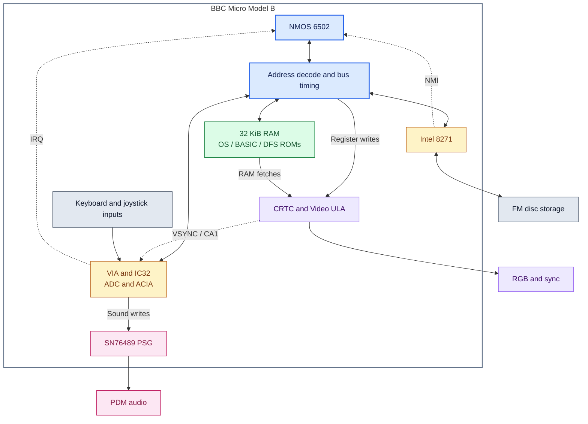
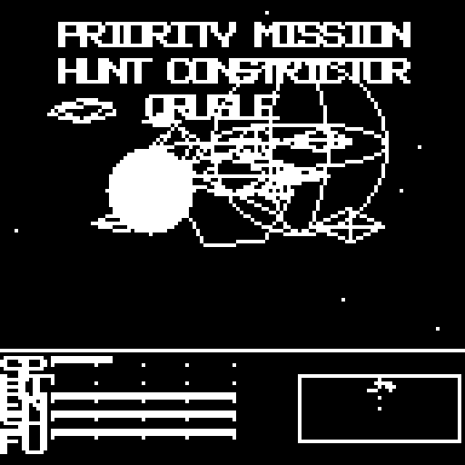

# Elite-A-FPGA

Elite-A-FPGA implements a BBC Micro Model B in SpinalHDL. The CPU and peripherals
run the released **Elite-A** disc with DFS 1.2, the original BBC ROMs and no Tube.
The test runner compares this machine with independent software models.

## Gameplay replay results

A frozen 96 MHz build matched the reference in 35 scenarios across three disc
profiles. Both machines booted independently and ran each scenario twice.

| What was compared        |         Count |
| ------------------------ | ------------: |
| Scenario comparisons     |            70 |
| State checkpoints        |           350 |
| Display fields           |       168,806 |
| Timed RAM and I/O writes |    48,752,212 |
| Digital audio samples    | 1,685,655,904 |

The counts apply to that build and those scenarios. Exhaustive simulator
equivalence, analogue I/O and physical FPGA validation remain open.
[Replay evidence and scope](docs/bbc-runtime.md#validation-status)

## BBC design



Both variants use one clock domain. The 96 MHz design advances the shared BBC
phases on every third master edge and generates exact 12 MHz teletext dots.
The 32 MHz variant supports bitmap video. CPU and video access the same RAM on
separate phases.

The 32 and 96 MHz hardware tops are `BbcSystemTop` and `BbcSystem96`. The
[architecture guide](docs/architecture.md) describes the simulation interfaces,
bus timing and interrupt connections.

## FPGA resource estimates

Yosys 0.52 mapped both hardware tops to Lattice ECP5.

| Hardware top   |  Clock |  LUT4s | Flip-flops | Block RAMs | Distributed RAMs | DSPs |
| -------------- | -----: | -----: | ---------: | ---------: | ---------------: | ---: |
| `BbcSystemTop` | 32 MHz | 14,746 |      1,761 |         38 |                5 |    1 |
| `BbcSystem96`  | 96 MHz | 14,652 |      1,880 |         39 |                5 |    1 |

Run `make bbc-synth` or `make bbc-synth96` to reproduce the counts. Verifying
board clock rates requires place and route.

## Getting started

Build on Linux with Git, GNU Make, JDK 17+, sbt, Verilator, C and C++17
compilers, Node.js 24.15+, Python 3.12+, pkg-config and OpenSSL development
headers. Use Yosys for synthesis and formal checks. Some proofs also need Z3 or
CBMC.

```sh
git clone https://github.com/rishivg/Elite-A-FPGA.git
cd Elite-A-FPGA
python3 -m venv .venv
source .venv/bin/activate
python -m pip install -r tools/validation/requirements.txt
npm ci --ignore-scripts --no-audit --no-fund
make bbc-build96
make validation-test-unit
```

The first build downloads the pinned game, ROMs and reference sources into
`build/` and checks their hashes. Use `make bbc-build` for the 32 MHz variant.
The full replay, `make bbc-validate96`, can take hours. Open
`workspace/build/bbc/latest/report.html` inside the printed run bundle.
[Replay and resume](docs/bbc-runtime.md#gameplay-replay) · [Local test suites](docs/testing.md)

## PicoRV32 demo

The separate PicoRV32 demo uses simplified gameplay and original-byte rendering
kernels. It needs RISC-V GCC. Interactive play also needs SDL2 development
headers and a display/audio session.

```sh
make fw gen lint
make test-fast   # Component checks
make test        # Components, original rendering kernels and demo scenarios
make play-smoke  # Headless frames
make play        # Interactive SDL2 demo
```

Move with WASD or the arrow keys and adjust throttle with comma or period.
Press Space to fire, X for a missile, C for the chart, M for the market
and F1 for help. Run `make vista` to capture the scene below in `build/sim/`.
[Firmware notes](fw/README.md) · [Demo validation](docs/elite-a-validation.md)



## Source layout

- `rtl/bbc/` and `tools/bbc/` contain the BBC RTL, reference runners and proofs.
- `rtl/render/elite/` contains the original-byte kernels. `rtl/soc/`, `rtl/top/`
  and `fw/` contain the demo and its board integration.
- `sim/`, `tests/`, and `tools/validation/` contain benches, test fixtures
  and independent comparisons.

[BBC video](docs/bbc-video.md) · [BBC ADC](docs/bbc-adc.md) ·
[Reference proofs](docs/bbc-reference-bridges.md) · [Pinned inputs](tools/validation/reference.lock.json) ·
[Annotated original source](https://www.bbcelite.com/)

## License

Project code and documentation use the [Apache License 2.0](LICENSE).
Bundled CPU cores, the original game, ROMs and downloaded reference code
retain their upstream terms. [Project and third-party notices](NOTICE)
