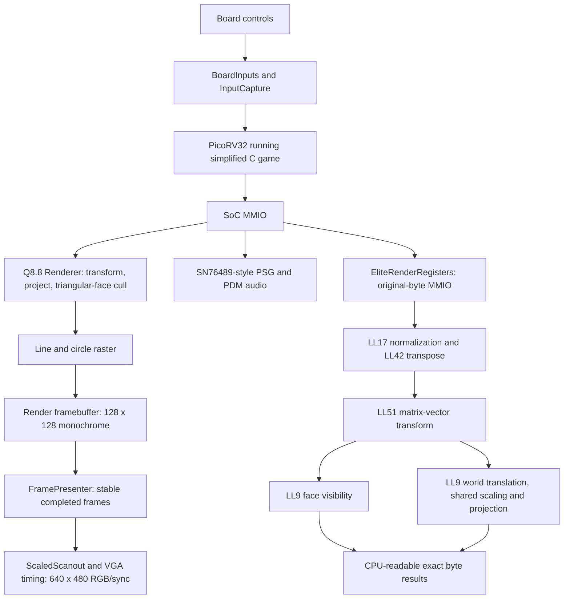

# Architecture

The primary design executes released Elite-A on a BBC Micro Model B with
DFS 1.2 and no Tube. It runs the original ROMs and game binary on BBC CPU,
peripheral and video RTL. A separate PicoRV32 demo uses simplified gameplay and
original-byte rendering kernels. Both designs use SpinalHDL for parameterized RTL and elaboration-time
connection checks. Verilator and Yosys consume the generated Verilog.

## BBC machine boundaries

The [README block diagram](../README.md#bbc-design) follows `BbcMachine` wiring.
`BbcSystemTop` at 32 MHz and `BbcSystem96` at 96 MHz expose the keyboard,
analogue axes and buttons, digital restart, external FM storage, RGB/sync and
PDM audio. Hardware elaboration omits asynchronous
RAM/ROM inspection and unused observation logic. Simulation exposes CPU,
register, video and audio observations for independent comparisons.

| Component                                             | Responsibility                                                                                    |
| ----------------------------------------------------- | ------------------------------------------------------------------------------------------------- |
| `Cpu6502`, `BbcCpu.v`                                 | Enabled NMOS CPU and bus wrapper; preparation derives the pinned Arlet core                       |
| `BbcAddressDecode`                                    | Device mirrors, ROM-select aliases, slow-access groups and absent-register reads                  |
| `BbcRam`, ROM/bank logic                              | Disjoint CPU/video RAM phases, synchronous ROM reads and registered CPU responses                 |
| `Via6522`, `ViaSerial`, `ViaControlPins`              | Timers, interrupts, GPIO, serial state and pin-level feedback                                     |
| `BbcSystemPins`                                       | Keyboard matrix, IC32 latch, scroll selection and sound-bus data/enable                           |
| `BbcSerial`                                           | MC6850 transmit deadlines, serial ULA selection and IRQ; fixture has no serial peer or tape image |
| `Adc7002`                                             | Analogue conversion and VIA completion endpoint                                                   |
| `Intel8271`                                           | Disc command protocol, NMI and external 16-bit FM clock/data word transport                       |
| `Crtc6845`, `BbcVideo`, `Saa5050Cell`, `TeletextFont` | CRTC counters, fetches, bitmap/cursor serialization, palette and teletext/font ROM                |
| `BbcAudio`, `BbcSoundBus`, `Psg`                      | Accepted sound bytes, generators, digital samples and PDM output                                  |

## Enables and accepted bus edges

Both master variants use one clock domain. The 96 MHz machine supplies a 32 MHz
enable every third edge; the same guest phases advance on that enable.

| Boundary                       | Rate / rule                                                           |
| ------------------------------ | --------------------------------------------------------------------- |
| CPU slots and serial scheduler | 2 MHz                                                                 |
| System/user VIA and ADC ticks  | 1 MHz                                                                 |
| Slow CPU access                | At least two slots; completion on a 1 MHz endpoint                    |
| Fast CPU access                | Either half of the 1 MHz period                                       |
| Bitmap timing                  | 16 MHz enables; selected mode determines pixel serialization          |
| Teletext dots                  | Exact 12 MHz in the 96 MHz variant; unsupported in the 32 MHz variant |
| FDC and sound domain           | 32 MHz enables, retained in the 96 MHz variant                        |

`cpuEnable` qualifies device read/write strobes, RAM/ROM capture and the
registered response selector. Peripheral clocks continue during CPU waits.
RAM's CPU and video ports accept requests on separate phases. Keeping both the
request and response pipelines explicit prevents read data from moving to a
neighboring accepted CPU transaction.

## Reset and interrupt endpoints

Power-on reset initializes the complete machine. The declared RAM fixture is
zero in zero page and FF elsewhere; guest software clears/overwrites it normally.
Digital `warmReset` reaches the CPU and FDC while other peripherals keep ticking.
See [digital restart](bbc-runtime.md#digital-restart) for the reference profile.

System/user VIA and serial transmit IRQs combine at the CPU IRQ input; FDC drives
NMI. Video VSYNC reaches system VIA CA1, ADC completion reaches CB1, and keyboard
CA2 reflects the physical matrix and IC32 feedback. Pin muxing and same-endpoint
forwarding matter because bus side effects and device completion can coincide.

Board PLLs, keyboard transport, storage and display/audio adapters remain
integration work. See [mapping estimates](../README.md#fpga-resource-estimates)
and [proof coverage](bbc-reference-bridges.md).

## Demo and renderer dataflow

The rendered view occupies the top 96 rows of the 128x128 framebuffer; simplified
HUD drawing uses the remaining rows. RGB scanout scales presented frames and
checks alignment through the real SoC. This does not reproduce the BBC's native
256x248 active colour display. Current wrappers export RGB/sync; ULX3S GPDI needs
TMDS encoding, and neither board has verified routed timing or physical capture.

## Released renderer organization

`rtl/render/elite/` keeps original signed-magnitude arithmetic separate from the
simplified Q8.8 path. These representations are not interchangeable. Full sign
bytes carry original low-bit tags, addition wraps at the original width, and
projection retains the original lossy division rather than using a precise
perspective formula.

`EliteRenderRegisters` owns decoding and face reservation/operand transfer.
`ElitePoseRegisters` owns vector, orientation and world operands and sequences
normalization, transformation and optional vertex processing. Busy writes and
starts are ignored; integrated kernels use held operands instead of duplicate
snapshots. Direct register tests instantiate the same production block as `Soc`.
Standalone kernels capture inputs for independent tests.

`EliteArithmetic` supplies the fractional division step. Orientation uses a
constant divisor of 197; projection shares a variable divider between axes.
Each transform/face stage shares one multiplier. All modules use the system clock
and explicit start/busy/completion handshakes.

[Demo validation](elite-a-validation.md) covers the MMIO map, the independent
renderer fixtures and remaining board work.
